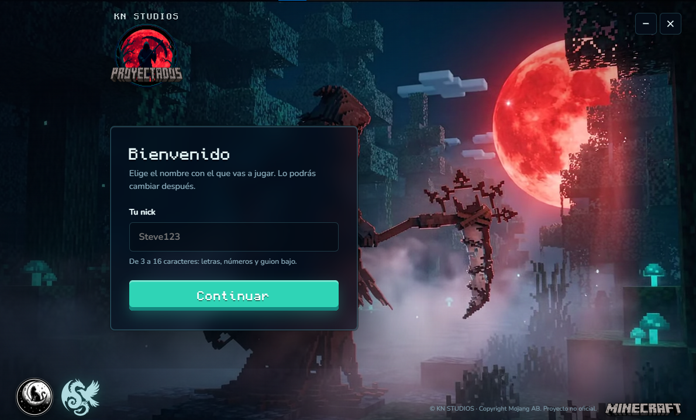
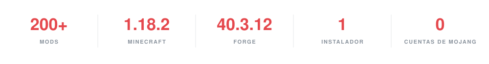
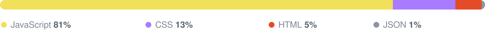
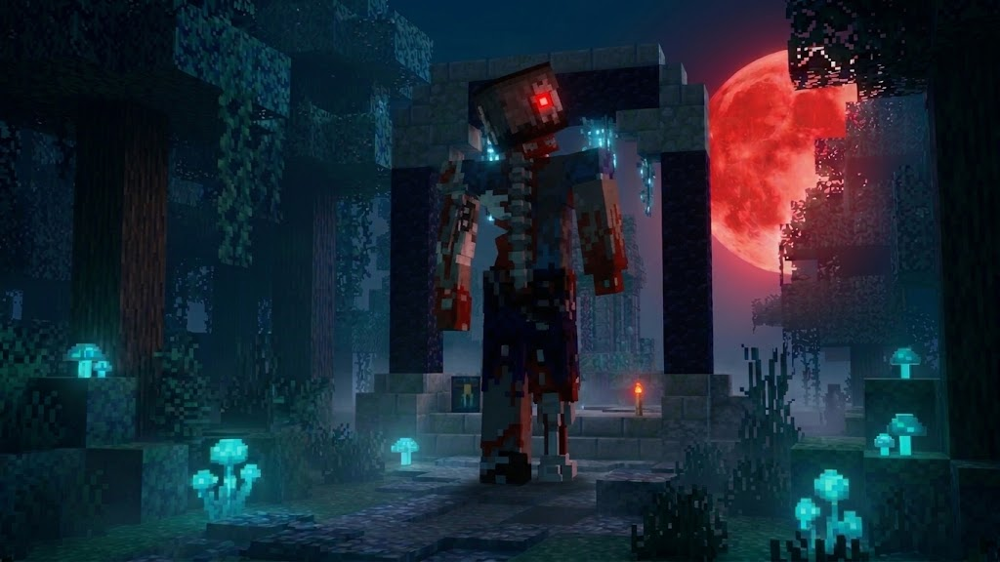
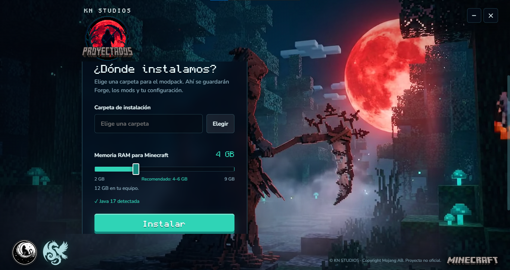
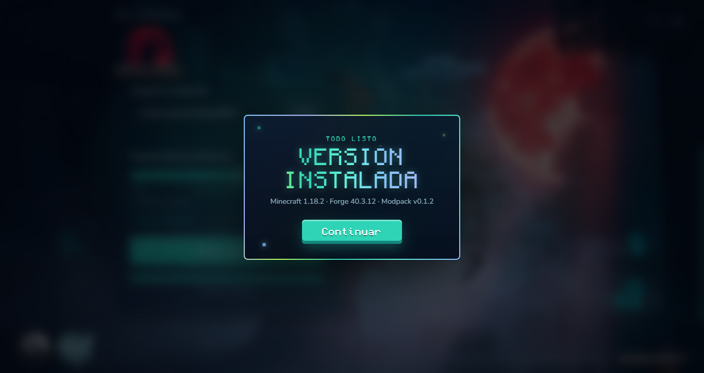
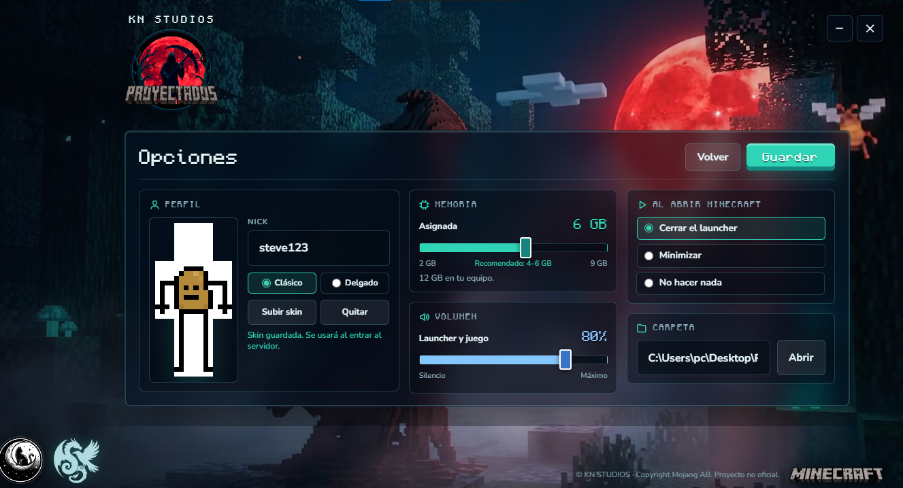

 

 

 

  

---

## Qué es

**PMC Launcher (PMCL)** es el launcher oficial de **Proyectados MC**, el servidor de KN STUDIOS. Descargas un .exe, escribes tu nick y el launcher se encarga de todo lo demás: instala Forge, prepara la instancia, baja los mods y abre el juego.

> **IMPORTANTE**
>
> Proyectados MC es un servidor **híbrido**: cualquiera puede entrar a nuestro Discord y asomarse a la comunidad, pero el modpack y este launcher se desarrollaron únicamente para jugar aquí. No es un launcher genérico, no sirve para otros modpacks ni otros servidores, y no pretendemos que lo haga.

---

## Por qué existe

Todo empezó con un grupo de amigos, un modpack de más de 200 mods y un problema que se repetía cada fin de semana: alguien quería jugar y arrancaba la misma odisea de capturas, carpetas equivocadas, mods faltantes y el clásico «a mí no me abre».

Durante meses fui el que se conectaba de madrugada a rescatar instalaciones ajenas, hasta que una noche juré que nadie de la comunidad volvería a pasar por eso. Así nació PMCL.

---

## Qué hace

<table>
<tr>
<td width="50%" valign="top">

**Instalación automática**
Forge, mods y dependencias se preparan solos. Tú eliges la carpeta y el launcher hace el resto.

</td>
<td width="50%" valign="top">

**Actualizaciones automáticas**
El modpack se mantiene al día desde fuentes que nosotros verificamos.

</td>
</tr>
<tr>
<td width="50%" valign="top">

**Menos carga**
Optimizaciones que reducen hasta un 20 % la carga de los mods.

</td>
<td width="50%" valign="top">

**RAM a tu medida**
Ajusta la memoria desde 2 GB hasta el 75 % de tu equipo.

</td>
</tr>
<tr>
<td width="50%" valign="top">

**Tu skin, tu identidad**
Súbela una vez y se verá en el launcher y dentro del servidor.

</td>
<td width="50%" valign="top">

**Cuenta offline**
Sin Mojang, sin registros. Solo tu nick.

</td>
</tr>
</table>

**Y los detalles que se agradecen**

- El juego se abre de forma independiente: puedes cerrar el launcher y Minecraft sigue corriendo.
- El volumen del launcher se sincroniza con el del juego.
- Al actualizar, tus teclas y ajustes se conservan.
- Si borras la carpeta de la instancia, el launcher te lleva de vuelta a la instalación sin romperse.

---

## Stack

El launcher corre sobre **Electron**, con **Minecraft 1.18.2 + Forge 40.3.12**. Esta es la composición real del proyecto.

---

## Capturas

 

 

---

## Instalación

1. Entra a [Releases](https://github.com/SR-KNOX/ProyectadosMC_Launcher/releases/latest) y descarga el instalador.
2. Ejecútalo con doble clic.
3. Elige la carpeta donde vivirá tu instancia.
4. Escribe tu nick.
5. Pulsa **Jugar**. El launcher se encarga del resto.

**Requisitos:** Windows 10 u 11, Java 17 o superior (se detecta automáticamente y, si falta, se descarga antes de instalar Forge) e internet la primera vez.

---

## Preguntas frecuentes

<b>¿Necesito una cuenta de Minecraft o de Mojang?</b>

 
No. PMCL funciona con cuenta offline: solo escribes tu nick.

<b>¿Puedo usarlo para otro servidor o para otros mods?</b>

 
No. PMCL está hecho únicamente para el modpack y el servidor de Proyectados MC.

<b>¿Qué pasa si no tengo Java?</b>

 
El launcher lo detecta y, si falta, descarga el runtime necesario antes de instalar Forge.

<b>¿Pierdo mis teclas y ajustes al actualizar el modpack?</b>

 
No. Las actualizaciones conservan tus teclas y tus ajustes.

<b>¿Puedo cerrar el launcher mientras juego?</b>

 
Sí. Minecraft se abre de forma independiente y sigue corriendo.

<b>Algo no funciona, ¿a quién le escribo?</b>

 
Entra al Discord o escribe directo a <b>knox.sr</b>. Ahí te ayudamos.

---

## Comunidad

<table>
<tr>
<td width="50%" align="center" valign="top">

</td>
<td width="50%" align="center" valign="top">

</td>
</tr>
</table>

> **Aquí no se juega solo.** Entra al servidor, preséntate y pregunta lo que sea. Siempre hay alguien armando partida.

<b>Primeros pasos en el servidor</b>

 

1. Entra con la tarjeta del servidor o con `discord.gg/kpbGykKhD2`.
2. Lee las reglas y preséntate en el canal de bienvenida.
3. Descarga el launcher, escribe tu nick y pulsa **Jugar**.
4. ¿Un bug o una idea? Escríbeme directo a **knox.sr**.

---

## Créditos

Desarrollado por [**Knox**](https://github.com/SR-KNOX) y con ayuda de [**Dobe**](https://github.com/vD0B3R0Tv).
Un proyecto de **KN STUDIOS**.

Hecho con [minecraft-java-core](https://www.npmjs.com/package/minecraft-java-core), [Electron](https://www.electronjs.org/), [Monocraft](https://github.com/IdreesInc/Monocraft) y [Nunito](https://fonts.google.com/specimen/Nunito).

Proyecto independiente, no afiliado a Mojang ni a Microsoft. Minecraft es propiedad de Mojang AB. Distribuido bajo licencia MIT, ver [LICENSE](LICENSE).

