

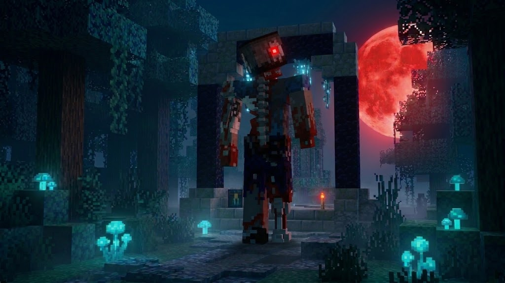

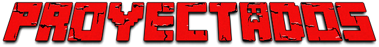

**El launcher oficial de Proyectados MC. Un .exe, un nick, y a jugar.**

---

# LAS TIERRAS INTERMEDIAS

> *Mientras la luna sangrienta cruje bajo las torres en ruinas, **Morthaël, el Segador del Fin**, despierta de su largo letargo.*
>
> *La deidad superior **Aetherion** ha reunido a tus amigos y a ti: un puñado de almas de otros mundos, convocados a las **Tierras Intermedias** con una sola consigna. Sobrevivir, explorar, recuperar. No hay poder en estas capas que no tenga un precio, y nadie en este mundo recuerda cómo fue el primer día.*

Esto es **Proyectados MC**: nuestro servidor híbrido, nuestro modpack — una aventura completa para jugar con amigos, sin cuenta, sin registro, sin que nadie te tome de la mano.

---

## Descargar y arranca

**Cómo arranca la partida:**

1. Descarga **`Proyectados.MC.Setup.1.0.0.exe`**.
2. Ejecútalo con doble clic e instala (Windows avisará — es normal en apps sin firma de pago).
3. Escribe tu nick de jugador.
4. Pulsa **Jugar**. El launcher instala Forge, prepara la instancia, descarga los mods y abre el mundo.

**Lo que necesita tu equipo:**

- Windows 10 o 11
- 4 GB de RAM libres (recomendado 4–6 GB)
- Java 17 (si no la tienes, el launcher la descarga e instala por ti)
- Internet la primera vez
- Tu nick — **sin cuenta de Microsoft, sin email, sin contraseña**

---

## Así se ve por dentro

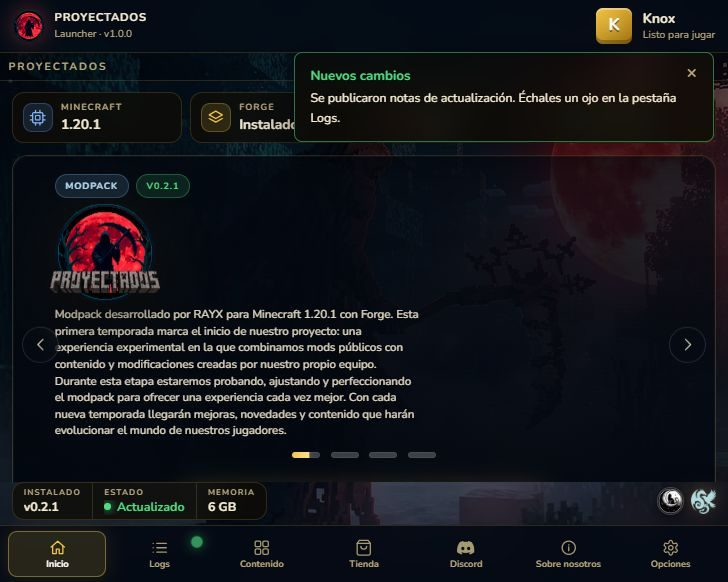

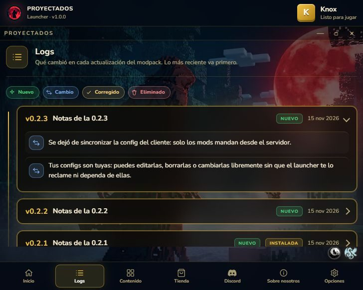

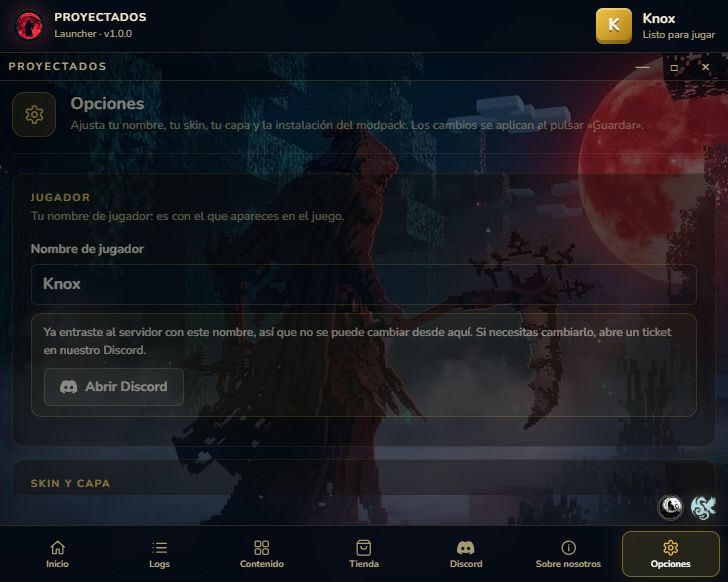

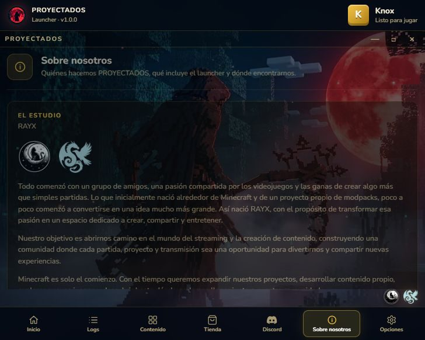

---

## Lo que trae el pack

<table>
<tr>
<td align="center">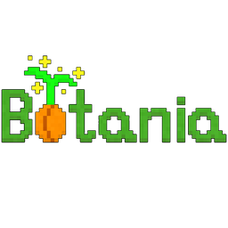 <b>Botania</b></td>
<td align="center">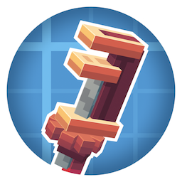 <b>Create</b></td>
<td align="center">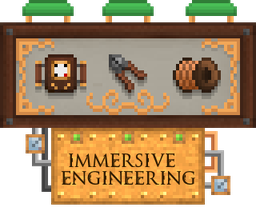 <b>Immersive Engineering</b></td>
<td align="center">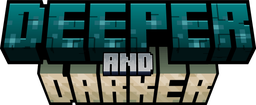 <b>Deeper and Darker</b></td>
<td align="center">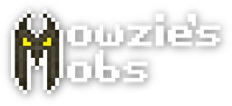 <b>Mowzie's Mobs</b></td>
<td align="center">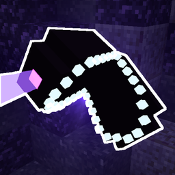 <b>Wither Storm</b></td>
</tr>
<tr>
<td align="center">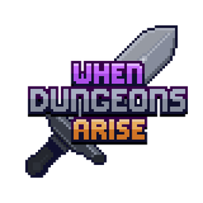 <b>Dungeons Arise</b></td>
<td align="center">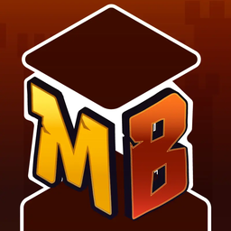 <b>Medieval Nether</b></td>
<td align="center">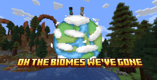 <b>Biomes We've Gone</b></td>
<td align="center">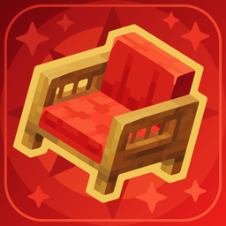 <b>Another Furniture</b></td>
<td align="center">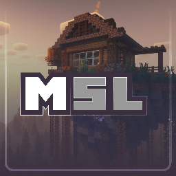 <b>Moog's Structures</b></td>
<td align="center">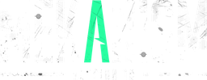 <b>Mekanism</b></td>
</tr>
<tr>
<td align="center">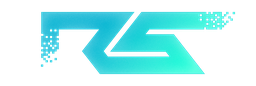 <b>Refined Storage</b></td>
<td align="center">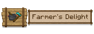 <b>Farmer's Delight</b></td>
<td align="center">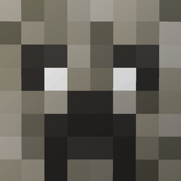 <b>Graveyard</b></td>
<td align="center">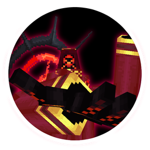 <b>Threateningly Mobs</b></td>
<td align="center">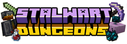 <b>Stalwart Dungeons</b></td>
<td align="center">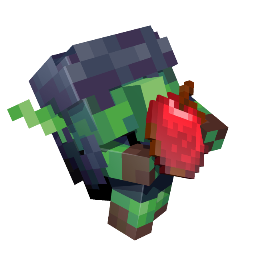 <b>Goblin Traders</b></td>
</tr>
<tr>
<td align="center">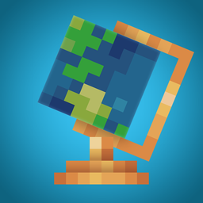 <b>Supplementaries</b></td>
<td align="center">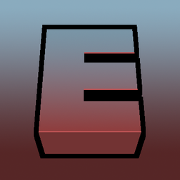 <b>EEE Abs Mobs</b></td>
<td align="center">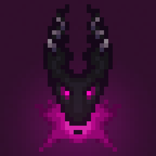 <b>Boss Bars</b></td>
<td align="center">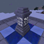 <b>Waystones</b></td>
<td align="center"> <b>Yung's Extras</b></td>
<td align="center">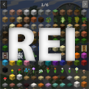 <b>REI</b></td>
</tr>
</table>

> *+ 170 mods más corriendo el pack completo.*

---

## La letra pequeña (jugando siempre es más divertido)

**Dentro puedes:** construir tu base y tu mini-estado, desbloquear estructuras, hacer alianzas y traiciones, meterle horas al server, echarte las manos a la cabeza con Morthaël, y básicamente ser tú.

**Fuera quedan:** los mods que sobran (bundle intacto), las manos largas y las malas ideas disfrazadas de "no pasa nada". Se aclaran con `knox.sr`.

| Puedes | No puedes |
|:---|:---|
| Explorar, tradear y grindear sin ser un fantasma | Ghosting: jugar solo sin interactuar con nadie |
| Romper y destruir lo que el mundo te ofrece | Romper el clima y la atmósfera para los demás |
| Usar tu propio nick y tu propia ruta | Usar hacks, clients modificados, PvP hopping abusivo |
| Pedir ayuda con una skin o un bug | Pedir siempre a Rett o a knox para que haga el tutorial |

> **Si dudas de algo, pregunta a knox.sr antes de asumir.**

---

## Únete a la comunidad


> **Aquí no se juega solo.** Entra al Discord, preséntate y pregúntale a alguien — siempre hay alguien armando una partida.

### Primeros pasos

1. Entra por [Discord](https://discord.gg/kpbGykKhD2) o descarga el launcher.
2. Lee las reglas y preséntate en **#bienvenida**.
3. Instala, escribe tu nick, **¡a jugar!**
4. ¿Bug o idea? Escríbele directo a **knox.sr**.

---

## Preguntas frecuentes

<b>¿Puedo jugar sin cuenta de Microsoft?</b>

Sí. Proyectados MC y su modpack funcionan en modo offline — sin Microsoft, sin Mojang.

<b>¿Funciona en Mac o Linux?</b>

Actualmente solo Windows 10/11. El build de Mac y Linux está en el horizonte.

<b>¿Tengo que comprar el juego?</b>

Si no tienes tu propia copia de Minecraft, Proyectados MC es la solución perfecta.

<b>¿Puedo usar mis propios mods?</b>

Manten los mods del pack — son los que valida el servidor. Si quieres añadir algo, pregúntale a knox.sr.

<b>¿Qué pasa con Windows Defender?</b>

El launcher no tiene firma digital (no es malware, solo software pequeño). Si Aviso sale, elige "Más información → Ejecutar igualmente". Si sigues dudando, avísale a knox.sr.

<b>¿Dónde se guarda mi partida?</b>

En la carpeta del launcher, por defecto: <code>%APPDATA%\Proyectados MC</code>. Tu nick y configuración se quedan en tu equipo.

---

## Legal

> Proyecto **no oficial**. Minecraft es una marca registrada de Mojang Studios. Proyectados MC es un proyecto de fans por **RAYX Studios**, en desarrollo activo y distribuido bajo **licencia MIT**. No redistribuye Minecraft, no representa a Mojang ni a Microsoft.

Distribuido bajo licencia [MIT](LICENSE). Ver [LICENSE](LICENSE).

---

*Hecho por [<b>Knox</b>](https://github.com/SR-KNOX) y [<b>Dobe</b>](https://github.com/vD0B3R0Tv) · RAYX Studios*

Proyecto independiente, no afiliado a Mojang ni a Microsoft. Minecraft © Mojang Studios.

